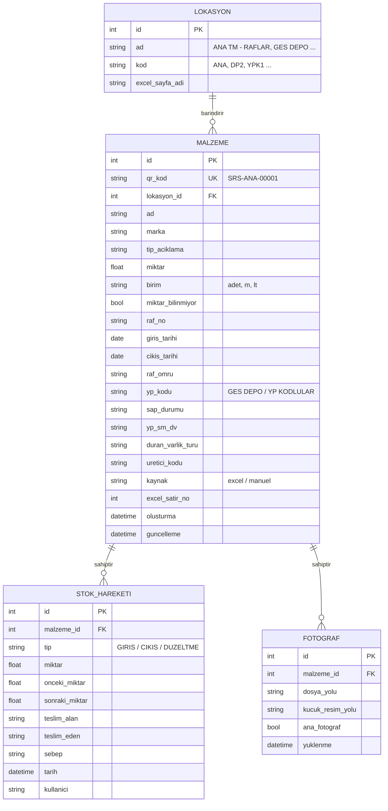
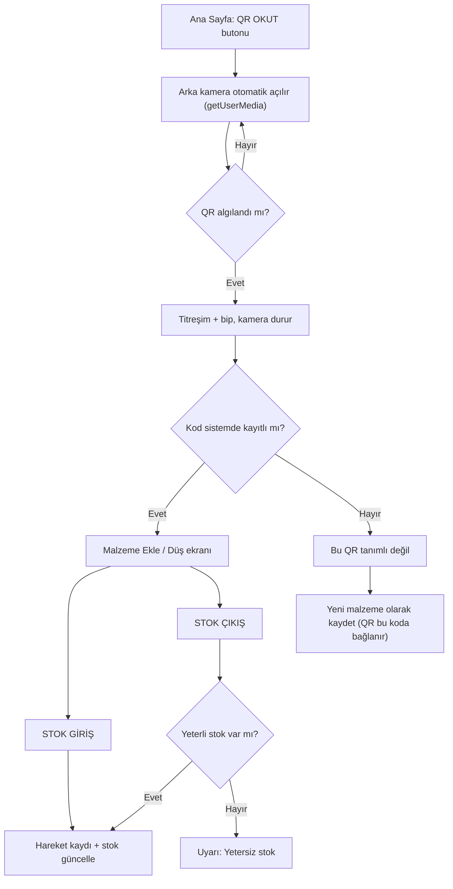
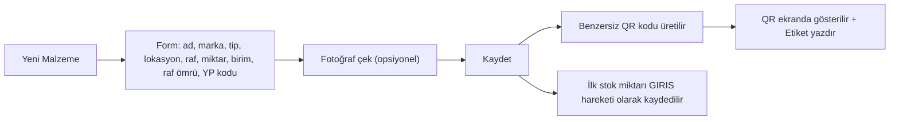

# Saros Depo – QR Kodlu Stok Takip Sistemi (Proje Tanım Dokümanı)

> **Kaynak dosya:** `FRM-OPR.GNL-02 Ambar Yerleşim Formu-Eylül.xlsx`
> **Amaç:** Excel'de lokasyon bazlı tutulan ambar yerleşim formunu; QR kodla telefondan stok giriş/çıkışı yapılabilen, fotoğraflı, düzenlenebilir bir mobil web uygulamasına dönüştürmek.

---

## 1. Mevcut Excel Analizi

### 1.1 Sayfalar (Lokasyonlar)

Her sayfa bir depolama lokasyonunu temsil eder. Sayfalardaki malzeme sayıları (başlık satırından sonra adı dolu olan satırlar):

| # | Sayfa / Lokasyon | Başlık satırı | Malzeme sayısı | Not |
|---|---|---|---|---|
| 1 | ANA TM - RAFLAR | 7 | 226 | Standart form, `ADET` içinde `-` değerleri var |
| 2 | DEPO-2 TAKIM TEZGAHI | 7 | 74 | Standart form, `RAF NO` = "Takım Tezgahı" (metin) |
| 3 | Y.P KUTU-1 | 7 | 27 | Standart form |
| 4 | Y.P KUTU-2 | 7 | 26 | Standart form |
| 5 | Y.P KUTU-3 | 7 | 19 | Standart form |
| 6 | Y.P KUTU-4 | 7 | 8 | Standart form |
| 7 | YP KODLULAR | 7 | 79 | **Farklı sütun yapısı** (birleşik hücre yok, `RAF NO` = "ŞALT SAHASI" vb.) |
| 8 | KONTEYNER | 7 | 9 | Standart form |
| 9 | ARABALI TAKIM DOLABI | 7 | 14 | Standart form |
| 10 | GES DEPO | **1** | 185 | **Tamamen farklı yapı** (SAP / YP / SM kodları var) |
| 11 | IT DOLABI | 7 | 21 | Standart form |
| 12 | XLPE Kablo Depo Alanı | 7 | 16 | `ADET` metrik (`50 m`, `100 m`) |
| 13 | TALİ TM | 7 | 26 | Standart form |
| 14 | YG ETİKET GÖRSELLERİ | – | – | **Malzeme listesi değil**, aktarılmayacak |
| | **TOPLAM** | | **≈ 730** | |

### 1.2 Sütun Yapıları

**A) Standart form (12 sayfa)** – satır 1-5 doküman başlığı, satır 6/7 başlık, `B:C` ve `E:F` birleşik hücre:

| Excel sütunu | Alan | Not |
|---|---|---|
| A | S.NO | Tekrar edebiliyor (ör. XLPE'de iki adet `8`) → anahtar olarak **kullanılmamalı** |
| B (B:C birleşik) | MALZEMENİN ADI | |
| D | MARKA | |
| E (E:F birleşik) | TİPİ-AÇIKLAMA | Çok satırlı olabilir (`\n`) |
| G | ADET | Sayı, `-`, boş veya `50 m` gibi birimli metin |
| H | RAF NO | Sayı veya metin |
| I | GİRİŞ T. | Tarih |
| J | ÇIKIŞ T. | Tarih |
| K | TESLİM A. (Teslim Alan) | |
| L | TESLİM E. (Teslim Eden) | |
| M | RAF ÖMRÜ | |
| N | GİRİŞ-ÇIKIŞ SEBEBİ | Serbest metin / SM kodu |

Sayfa sonunda (≈ satır 48-51) imza/onay alanları vardır, aktarımda hariç tutulmalıdır.

**B) YP KODLULAR** – Birleşik hücre yok: `S.NO, MALZEMENİN ADI, MARKA, TİPİ-AÇIKLAMA, ADET, RAF NO, GİRİŞ T., ÇIKIŞ T., TESLİM A., TESLİM E., RAF ÖMRÜ, GİRİŞ-ÇIKIŞ SEBEBİ` (A–L).

**C) GES DEPO** – Başlık 1. satırda:
`NO, MALZEMENİN ADI, MARKA, TİPİ-AÇIKLAMA, ADET, SAP dışında tutulan stok, Duran Varlık Kodu & YP KODU, YP&SM&DV, Duran Varlık Türü, ÜRETİCİ KODU, RAF NO` (raf örn. `GD A3`, `GD B1`).

### 1.3 Veri Temizliği Gereken Noktalar

- Aynı malzeme farklı lokasyonlarda bulunabiliyor (ör. *Emniyet Zinciri Plastik* hem ANA TM hem TALİ TM'de) → **her lokasyon+malzeme ayrı kayıt ve ayrı QR**.
- Aynı isimli fakat farklı tipte malzemeler var (ör. *Kurbağacık Anahtar 8"/10"/12"*, *SİGORTA 5SL…*) → isim tek başına benzersiz değil.
- `ADET` alanı: `-` / boş → `0` + "miktar bilinmiyor" işareti; `50 m`, `150 M`, `220LT` → **miktar (sayı) + birim (m, lt, adet)** olarak ayrıştırılmalı.
- Excel'de malzeme fotoğrafı yok (sayfalardaki tek görsel firma logosu) → **başlangıçta tüm kayıtlar fotoğrafsız**.
- Tarihler `datetime`, bazı hücreler boş.

---

## 2. Sistem Gereksinimleri

### 2.1 Fonksiyonel Gereksinimler

| Kod | Gereksinim |
|---|---|
| F1 | Excel'deki **tüm mevcut malzemeler** sisteme aktarılacak ve her birine **benzersiz QR kod** üretilecek. |
| F2 | QR kodlar lokasyon bazlı **yazdırılabilir etiket sayfası** (PDF/A4 etiket) olarak alınabilecek. |
| F3 | Listede olmayan **yeni malzeme** eklenebilecek; özellikleri girilecek, kayıt anında **QR otomatik tanımlanacak**. |
| F4 | Yeni malzeme kaydında **fotoğraf** eklenebilecek. |
| F5 | **"QR Okut"** butonuna basıldığında telefon **arka kamerası doğrudan açılacak** ve QR **otomatik okunacak** (galeriden resim seçme / fotoğraf çekip yükleme YOK). |
| F6 | Tanımlı bir QR okutulduğunda **Malzeme Ekle / Malzeme Düş** ekranı açılacak: aynı malzemeye stok girişi ve stok çıkışı yapılabilecek. |
| F7 | Tanımsız bir QR okutulursa kullanıcıya "Bu QR tanımlı değil – yeni malzeme olarak kaydet?" seçeneği sunulacak (önceden basılmış boş etiketler için). |
| F8 | **Düzenleme alanı:** depodaki mevcut malzemelerin tüm bilgileri (ad, marka, tip, lokasyon, raf, birim, raf ömrü vb.) düzenlenebilecek. |
| F9 | Düzenleme alanından, **fotoğrafı olmayan** mevcut malzemelere fotoğraf eklenebilecek / mevcut fotoğraf değiştirilebilecek. "Fotoğrafı olmayanlar" filtresi olacak. |
| F10 | Her stok hareketi (giriş/çıkış) tarih, miktar, teslim alan, teslim eden, sebep bilgisiyle **hareket geçmişine** kaydedilecek. |
| F11 | Stok çıkışında mevcut miktardan fazla düşülmesi engellenecek. |
| F12 | Lokasyon / raf / isim / marka ile arama ve filtreleme yapılabilecek. |
| F13 | Veriler, orijinal **FRM-OPR.GNL-02 formatında Excel'e geri aktarılabilecek** (her lokasyon ayrı sayfa). |

### 2.2 Fonksiyonel Olmayan Gereksinimler

- **Telefon öncelikli** (mobile-first) arayüz; büyük butonlar, tek elle kullanım.
- Kamera erişimi için tarayıcılar **HTTPS** zorunlu tutar (yerel ağda da sertifika gerekir) → bkz. Bölüm 8.
- Android (Chrome) ve iOS (Safari) desteklenmeli.
- Türkçe arayüz, Türkçe karakter desteği (İ, ı, Ş, ğ…).
- Uygulama yükleme gerektirmemeli → **PWA (Progressive Web App)**, ana ekrana eklenebilir.

---

## 3. Önerilen Teknoloji Yığını

| Katman | Teknoloji | Gerekçe |
|---|---|---|
| Backend | **Python 3 + FastAPI** | Hafif, hızlı, Excel işlemleri için Python ekosistemi |
| Veritabanı | **SQLite** (ileride PostgreSQL) | Tek dosya, kurulum gerektirmez |
| Excel okuma/yazma | `openpyxl` | Mevcut form formatını koruyarak dışa aktarma |
| QR üretimi | `qrcode[pil]` | PNG/SVG QR üretimi |
| Etiket PDF | `reportlab` | A4 üzerine çoklu QR etiket |
| Fotoğraf işleme | `Pillow` | Yeniden boyutlandırma / sıkıştırma / küçük resim |
| Frontend | HTML + CSS + Vanilla JS (PWA) | Derleme gerektirmez, telefonda hızlı |
| QR okuma | **`html5-qrcode`** (veya `@zxing/browser`) | `getUserMedia` ile canlı kamera akışından otomatik okuma |

---

## 4. Veri Modeli



### 4.1 QR Kod İçeriği

- **Benzersiz kod formatı:** `SRS-<LOKASYON_KODU>-<5 haneli sıra>` → örn. `SRS-ANA-00017`, `SRS-GES-00142`.
- **QR içine yazılacak veri:** `https://<sunucu>/m/SRS-ANA-00017`
  - Uygulama içi tarayıcıyla okunduğunda → kod ayrıştırılır, doğrudan **Ekle/Düş** ekranı açılır.
  - Telefonun kendi kamera uygulamasıyla okunursa da aynı sayfa tarayıcıda açılır (yedek senaryo).
- QR kod veritabanında **değişmez**; malzeme düzenlense, lokasyonu değişse bile aynı kalır (basılı etiket geçerliliğini korur).

### 4.2 Lokasyon Kodları (öneri)

| Lokasyon | Kod |
|---|---|
| ANA TM - RAFLAR | ANA |
| DEPO-2 TAKIM TEZGAHI | DP2 |
| Y.P KUTU-1 … 4 | YK1 … YK4 |
| YP KODLULAR | YPK |
| KONTEYNER | KNT |
| ARABALI TAKIM DOLABI | ATD |
| GES DEPO | GES |
| IT DOLABI | ITD |
| XLPE Kablo Depo Alanı | XLP |
| TALİ TM | TAL |

---

## 5. Ekranlar ve Akışlar

### 5.1 Ekran Listesi

| Ekran | İçerik |
|---|---|
| **Ana Sayfa** | Büyük **📷 QR OKUT** butonu, "Yeni Malzeme", "Malzemeler / Düzenle", "QR Etiket Yazdır", "Excel'e Aktar" |
| **QR Tarayıcı** | Tam ekran canlı kamera, ortada hedef çerçevesi, fener (flaş) aç/kapa, kapat butonu |
| **Ekle / Düş** | Fotoğraf, ad, marka, tip, lokasyon, raf, **mevcut stok** (büyük punto); miktar girişi (− / + butonları), teslim alan/eden, sebep; **[ STOK GİRİŞ ]** (yeşil) ve **[ STOK ÇIKIŞ ]** (kırmızı) butonları; son 5 hareket |
| **Yeni Malzeme** | Form + fotoğraf çek + kaydet → QR otomatik oluşur ve gösterilir/yazdırılır |
| **Malzeme Listesi** | Arama, lokasyon filtresi, "📷 Fotoğrafsızlar" filtresi, kart görünümü (küçük resim / fotoğraf yok ikonu) |
| **Malzeme Düzenle** | Tüm alanlar düzenlenebilir, fotoğraf ekle/değiştir/sil, QR'ı görüntüle/yeniden yazdır, hareket geçmişi |
| **QR Etiket Yazdır** | Lokasyon veya seçili malzemeler için A4 PDF etiket (QR + kod + ad + raf) |

### 5.2 QR Okutma Akışı



### 5.3 QR Tarayıcı Davranışı (kritik)

- "QR Okut"a basıldığında **ek bir tıklama, dosya seçici veya galeri ekranı açılmaz**; doğrudan canlı kamera görüntüsü gelir.
- `facingMode: "environment"` ile **arka kamera** seçilir.
- Kamera akışı sürekli taranır (≈ 10 fps), QR görüntüye girer girmez **otomatik** okunur; "çek" butonu yoktur.
- Başarılı okumada: `navigator.vibrate(200)` + kısa ses, aynı kodun tekrar tetiklenmesini önlemek için tarayıcı durdurulur.
- Karanlık depo ortamı için **fener (torch)** butonu (destekleyen cihazlarda).
- İlk kullanımda tarayıcı kamera izni ister; izin reddedilirse açıklayıcı uyarı gösterilir.

Örnek (html5-qrcode):

```javascript
const scanner = new Html5Qrcode("reader");
scanner.start(
  { facingMode: "environment" },
  { fps: 10, qrbox: { width: 250, height: 250 } },
  async (decodedText) => {
    await scanner.stop();
    navigator.vibrate?.(200);
    const kod = decodedText.split("/m/").pop();   // URL veya düz kod
    window.location.href = `/islem/${encodeURIComponent(kod)}`;
  }
);
```

### 5.4 Fotoğraf Ekleme

- **Yeni malzeme kaydı** ve **Düzenleme** ekranlarında "📷 Fotoğraf Çek" butonu.
- Telefonda kamera doğrudan açılır: `<input type="file" accept="image/*" capture="environment">` (veya uygulama içi `getUserMedia` önizleme + "Çek" butonu).
- İsteğe bağlı ikinci buton: "Galeriden Seç" (önceden çekilmiş fotoğraflar için).
- Sunucuda: en uzun kenar 1280 px'e küçültme, JPEG %80 kalite, 300 px küçük resim, EXIF yönüne göre döndürme.
- Malzeme başına birden fazla fotoğraf, biri **ana fotoğraf**.
- Liste ekranında fotoğrafsız ürünler belirgin ikonla gösterilir ve **"Fotoğrafsızlar"** filtresiyle toplu tamamlanabilir.

### 5.5 Yeni Malzeme Ekleme Akışı



- Zorunlu alanlar: **Malzeme adı, Lokasyon, Miktar, Birim**.
- Kaydetmeden önce aynı lokasyonda benzer isim+tip varsa "Bu malzeme zaten olabilir" uyarısı (mükerrer kayıt önleme).

---

## 6. API Uç Noktaları (Taslak)

| Metot | Yol | Açıklama |
|---|---|---|
| GET | `/api/lokasyonlar` | Lokasyon listesi |
| GET | `/api/malzemeler?q=&lokasyon=&fotografsiz=1` | Arama/filtre |
| GET | `/api/malzemeler/qr/{qr_kod}` | QR koda göre malzeme (okutma sonrası) |
| GET | `/api/malzemeler/{id}` | Detay + fotoğraflar + son hareketler |
| POST | `/api/malzemeler` | Yeni malzeme (QR otomatik üretilir) |
| PUT | `/api/malzemeler/{id}` | Malzeme düzenle |
| DELETE | `/api/malzemeler/{id}` | Pasife al (soft delete) |
| POST | `/api/malzemeler/{id}/hareket` | `{tip: GIRIS/CIKIS, miktar, teslim_alan, teslim_eden, sebep}` |
| GET | `/api/malzemeler/{id}/hareketler` | Hareket geçmişi |
| POST | `/api/malzemeler/{id}/fotograf` | Fotoğraf yükle (multipart) |
| DELETE | `/api/fotograflar/{id}` | Fotoğraf sil |
| GET | `/api/qr/{qr_kod}.png` | QR görseli |
| GET | `/api/etiketler.pdf?lokasyon=&ids=` | Yazdırılabilir etiket PDF |
| POST | `/api/excel/ice-aktar` | İlk aktarım (tek seferlik / yönetici) |
| GET | `/api/excel/disa-aktar` | FRM-OPR.GNL-02 formatında Excel |

---

## 7. Excel İçe Aktarma Kuralları

1. `YG ETİKET GÖRSELLERİ` sayfası atlanır.
2. Her sayfada `MALZEMENİN ADI` içeren satır **başlık satırı** kabul edilir (standart sayfalarda 6./7. satır, GES DEPO'da 1. satır); sütun eşleşmesi başlık metnine göre **dinamik** yapılır (sabit sütun harfi kullanılmaz – YP KODLULAR ve GES DEPO farklı).
3. Başlıktan sonra `MALZEMENİN ADI` dolu olan her satır bir malzemedir; imza/onay satırları ve boş satırlar atlanır.
4. `ADET` ayrıştırma:
   - Sayı → `miktar`, `birim = adet`
   - `"50 m"`, `"150 M"` → `miktar = 50/150`, `birim = m`
   - `"220LT"` → `miktar = 220`, `birim = lt`
   - `"-"` / boş → `miktar = 0`, `miktar_bilinmiyor = true` (sonradan sayım ile düzeltilir)
5. Excel'deki `GİRİŞ T.` doluysa ilk hareket olarak `GIRIS` kaydı oluşturulur; `ÇIKIŞ T.`, `TESLİM A./E.`, `SEBEP` bilgileri hareket notuna taşınır.
6. GES DEPO'ya özel alanlar (`YP KODU`, `SAP`, `YP&SM&DV`, `Duran Varlık Türü`, `Üretici Kodu`) ilgili alanlara yazılır.
7. Her kayda `SRS-<LOK>-<sıra>` QR kodu atanır; `excel_satir_no` izlenebilirlik için saklanır.
8. Aktarım sonunda rapor: sayfa bazlı aktarılan / atlanan / miktarı belirsiz kayıt sayıları.

---

## 8. Telefonla Kullanım ve Yayına Alma

- **Kamera = HTTPS şartı:** Tarayıcılar `getUserMedia`'yı yalnızca `https://` veya `localhost` üzerinde açar. Seçenekler:
  1. Şirket içi sunucu + kurum SSL sertifikası (önerilen),
  2. Geliştirme/test için `mkcert` ile yerel sertifika veya `cloudflared` / `ngrok` tüneli.
- Telefonlar sunucuyla **aynı ağda** (Wi-Fi) veya tünel üzerinden erişir.
- PWA manifest + service worker ile ana ekrana "Saros Depo" ikonu eklenir.
- Basit kullanıcı girişi (isim/PIN) → hareketlerde `kullanici` alanı otomatik dolar.
- Günlük otomatik yedek: SQLite dosyası + `fotograflar/` klasörü.

---

## 9. Proje Klasör Yapısı (Öneri)

```
Saros Depo/
├── app/
│   ├── main.py              # FastAPI uygulaması, router'lar
│   ├── database.py          # SQLite bağlantısı
│   ├── models.py            # Tablolar
│   ├── schemas.py           # Pydantic şemaları
│   ├── excel_import.py      # Excel → DB aktarımı
│   ├── excel_export.py      # DB → FRM-OPR.GNL-02 formatı
│   ├── qr_service.py        # QR üretimi + etiket PDF
│   └── photo_service.py     # Fotoğraf küçültme / kayıt
├── static/
│   ├── index.html           # Ana sayfa
│   ├── scan.html            # QR tarayıcı
│   ├── islem.html           # Ekle / Düş
│   ├── malzemeler.html      # Liste + düzenleme
│   ├── yeni.html            # Yeni malzeme
│   ├── css/app.css
│   ├── js/                  # app.js, scanner.js, html5-qrcode.min.js
│   ├── manifest.json
│   └── sw.js
├── data/
│   ├── saros_depo.db
│   └── fotograflar/
├── kaynak/
│   └── FRM-OPR.GNL-02 Ambar Yerleşim Formu-Eylül.xlsx
├── requirements.txt
└── README.md
```

---

## 10. Geliştirme Aşamaları

| Aşama | Kapsam | Çıktı |
|---|---|---|
| 1 | Veritabanı + Excel içe aktarma | ≈ 730 malzeme DB'de, aktarım raporu |
| 2 | QR üretimi + etiket PDF | Lokasyon bazlı yazdırılabilir QR etiketleri |
| 3 | Malzeme listesi, arama, düzenleme | Düzenleme alanı |
| 4 | Fotoğraf çekme/yükleme | Yeni kayıt + düzenlemede fotoğraf, "Fotoğrafsızlar" filtresi |
| 5 | Canlı kamera ile QR okuma + Ekle/Düş ekranı | Telefonla stok giriş/çıkış |
| 6 | Yeni malzeme kaydı + otomatik QR | Listede olmayan malzeme ekleme |
| 7 | Hareket geçmişi + Excel dışa aktarma | FRM-OPR.GNL-02 formatında rapor |
| 8 | HTTPS, PWA, kullanıcı girişi, yedekleme | Sahada kullanıma hazır sürüm |

---

## 11. Kabul Kriterleri

- [ ] Excel'deki 13 malzeme sayfasının tamamı aktarıldı, her malzemenin benzersiz QR kodu var.
- [ ] Telefonda "QR Okut"a basınca **galeri/dosya seçici açılmadan** arka kamera canlı açılıyor ve QR **otomatik** okunuyor.
- [ ] Kayıtlı QR okutulunca Ekle/Düş ekranı açılıyor; giriş stoku artırıyor, çıkış azaltıyor, stoktan fazla çıkışa izin verilmiyor.
- [ ] Tanımsız QR okutulunca yeni malzeme kaydına yönlendiriyor.
- [ ] Yeni malzeme fotoğraflı kaydedilebiliyor ve kayıt anında QR oluşuyor.
- [ ] Düzenleme alanından tüm alanlar güncellenebiliyor; fotoğrafsız ürünlere fotoğraf eklenebiliyor.
- [ ] Her hareket tarih, kişi, miktar ve sebep ile geçmişte görünüyor.
- [ ] Veriler orijinal form formatında Excel'e aktarılabiliyor.

---

## 12. Netleştirilmesi Gereken Konular

1. Uygulama nerede barındırılacak? (şirket içi sunucu / bulut / tek bir PC)
2. Kullanıcı yetkilendirmesi gerekli mi? (ör. sadece yetkililer düzenleme/silme yapabilsin)
3. QR etiket boyutu ve yazıcı tipi (A4 etiket kağıdı mı, termal etiket yazıcısı mı?)
4. Malzemeler lokasyonlar arası **transfer** edilebilecek mi? (ör. ANA TM → TALİ TM)
5. GES DEPO'daki SAP/YP kodlu malzemeler için SAP ile entegrasyon ihtiyacı var mı?
6. Excel dışa aktarımı aylık form (ör. "Ekim") olarak mı üretilecek?
